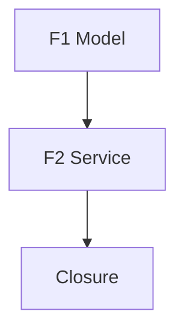

> **Purpose:** Example multi-agent plan with verifiable acceptance per phase.
> **Função:** Demonstrar frontmatter, aceite, risco e encerramento no loop engineering.

# Example — Item CRUD (template)

## Context

| Item | Detail |
|------|--------|
| Branch | `feature/example-item` |
| Objective | Demonstrate plan structure for Cursor/Claude comparison |
| Correlation ID | `run-20261122-a1b2c3d4` |
| Reference | `src/models/` (create when implementing for real) |
| Critical files | `src/main.py` |
| Final validation | `pytest tests/ -x` (placeholder) |
| Human gates | None (reversible draft only) |

## Dependency diagram

## Execution conventions

- Code in English; user chat PT-BR/EN as requested
- Parallel: not applicable (sequential phases)
- Who executes does not review — closure is a separate check
- Validation only at Closure

## Models per phase

| Phase | Tier |
|-------|------|
| F1 | economy |
| F2 | mid |
| F3 | economy |

---

## Phase F1 — Model and schemas

**Objective:** Define Item entity and create/response contracts.

**Inputs:** Briefing; existing model patterns if any.

**Output format:** `item` model + create/response schemas.

**Acceptance criteria:**
- [ ] Schema rejects empty `name`
- [ ] Response excludes internal-only fields
- [ ] Files exist at declared paths

**Files:**
- `src/models/item.py` (create — when real code exists)
- `src/schemas/item.py` (create)

**Behavioral changes:**
- Fields: `id`, `name`, `is_active`, timestamps

**Risk:** reversible · `requires_human_approval: false`

**Dependencies:** none

---

## Phase F2 — Service

**Objective:** list/create operations with domain validation.

**Inputs:** F1 schemas.

**Output format:** service module + unit tests.

**Acceptance criteria:**
- [ ] `list_items` and `create_item` implemented
- [ ] Tests cover happy path and 422
- [ ] `pytest` subset for this module exits 0 (when code exists)

**Files:**
- `src/services/item_service.py` (create)

**Behavioral changes:**
- Clear domain errors on invalid create

**Risk:** reversible · `requires_human_approval: false`

**Dependencies:** F1

---

## Closure

**Acceptance criteria:**
- [ ] Project validation command exits 0
- [ ] All `todo.status` = completed
- [ ] Evidence attached under `work/<correlation-id>/executor/evidence/` when executed via `/multiagent`
