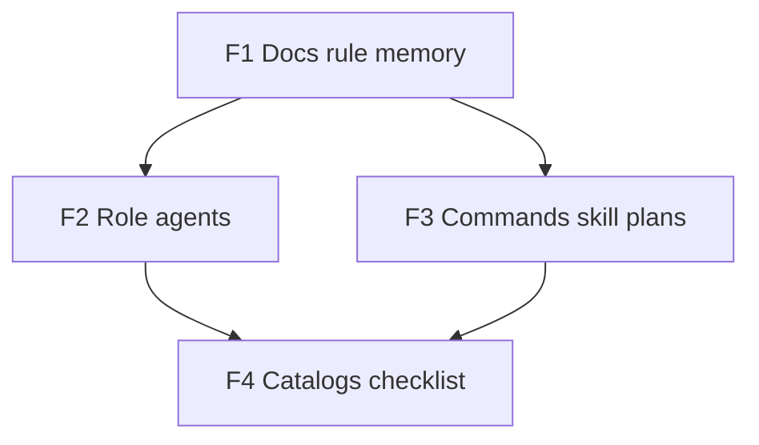

> **Purpose:** Plan to adapt this repo to the multi-agent engineering loop.
> **Função:** Orquestrar docs, agents, commands, memória e checklist conforme o documento de fluxo.

# Adapt multi-agent engineering loop

## Context

| Item | Detail |
|------|--------|
| Source | Uploaded flow: papéis, gates, memória, loops, autonomia por risco |
| Objective | Make `.cursor/` and `.claude/` operate as that loop |
| Critical files | `CLAUDE.md`, `.cursor/commands/multiagent.md`, plan-architect rule |
| Validation | Checklist in docs + example plan with acceptance criteria |

## Dependency diagram

## Conventions

- Canonical agent-facing text: EN-US; user chat: PT-BR
- Who executes does not review; only orchestrator writes durable memory
- Isolated workspaces per agent; fail closed; human approval for external effects

## Phase F1 — Docs, rule, memory

**Objective:** Publish the loop as source of truth and short always-on principles.

**Files:**
- `docs/MULTIAGENT_ENGINEERING_LOOP.md` (create)
- `docs/MULTIAGENT_ENGINEERING_LOOP.pt-BR.md` (create)
- `.cursor/rules/core-rules/multiagent-loop-always.mdc` (create)
- `.cursor/memory/README.md` + work/durable/log skeletons (create)
- `.claude/memory/` layer docs update

**Acceptance:** Docs describe roles/gates; rule is short; memory write rules match §6.

## Phase F2 — Role agents

**Objective:** One agent file per role in both scaffolds.

**Files:** `.cursor/agents/{intake,orchestrator,planner,architect,engineer,executor,reviewer}.md` and matching `.claude/agents/`.

**Acceptance:** Each role has read/write scope, exit gate, and loop limits.

## Phase F3 — Commands and planning

**Objective:** Wire `/multiagent` as orchestrator entry; plans require acceptance criteria and risk.

**Acceptance:** Commands reference roles; plan-architect requires verifiable acceptance; skill documents full loop.

## Phase F4 — Catalogs and checklist

**Objective:** Indexes and go-live checklist match §10 of the flow doc.

**Acceptance:** READMEs list new artifacts; checklist file present with suite placeholder.
